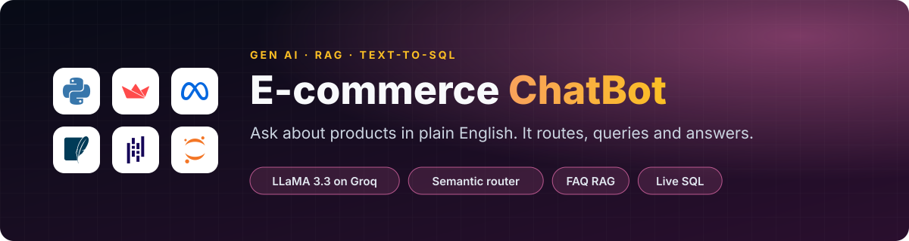
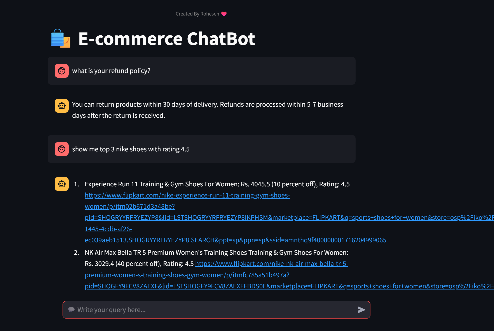
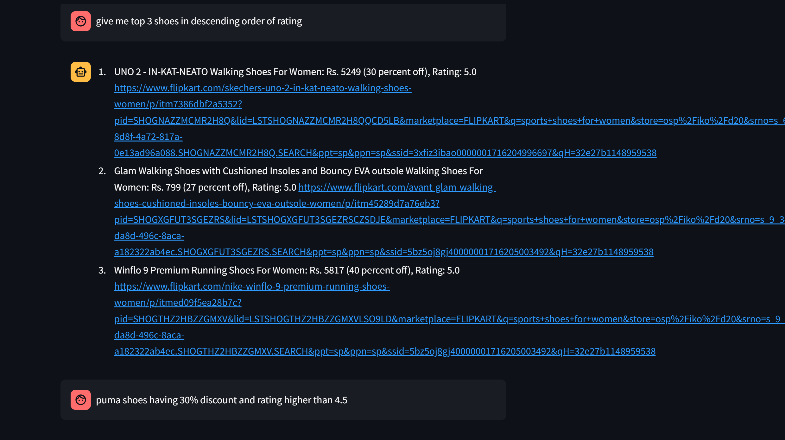

<p align="center">
  
</p>

<p align="center">
  <a href="https://e-commerce-chatbot-using-llama-33-and-groq-4qnsvcntgmrubdnuvlx.streamlit.app/"></a>
  
  
  
  
</p>

<p align="center">
  <a href="#-supported-intents">Intents</a> ·
  <a href="#-architecture">Architecture</a> ·
  <a href="#-screenshots">Screenshots</a> ·
  <a href="#%EF%B8%8F-set-up--execution">Set-up</a> ·
  <a href="#-demo-video">Demo</a>
</p>

---

> This is a **Proof of Concept (POC)** for an intelligent chatbot specifically designed for an **e-commerce platform**.

The chatbot enhances user experience by understanding natural language queries and identifying user intent with precision. It uses **Retrieval-Augmented Generation (RAG)** with **LLaMA 3.3** via the **Groq API** to deliver accurate and real-time responses.

🔍 It integrates with the platform's database, enabling dynamic interactions such as fetching products or answering platform-related FAQs.

<p align="center">
  <a href="https://e-commerce-chatbot-using-llama-33-and-groq-4qnsvcntgmrubdnuvlx.streamlit.app/"><b>🚀 Try the live app</b></a>
</p>

## 💡 Supported Intents

| Intent | What it does | Example |
|---|---|---|
| ❓ **FAQ** | Responds to general questions about the platform's policies and services | *"Is online payment available?"* |
| 🛒 **SQL** | Executes live queries on the product database to return relevant results | *"Show me all Nike shoes below ₹3000"* |

Each query is classified by a semantic router (`semantic-router` with `all-MiniLM-L6-v2` embeddings). Greetings and casual messages go to a small-talk route.

## 🧠 Architecture

```text
User Query ➡️ Router ➡️ (FAQ or SQL) ➡️ Groq (LLaMA 3.3) ➡️ Response ➡️ Chat Interface
```

<p align="center">
  
</p>

## 🧰 Tech Stack

| Layer | Tools |
|---|---|
| LLM | LLaMA 3.3 70B via **Groq** |
| Routing | **semantic-router**, sentence-transformers |
| FAQ retrieval (RAG) | **ChromaDB** vector store |
| Product data | **SQLite**, built from scraped Flipkart product data (`web-scrapping/`) |
| UI | **Streamlit** |

## 📸 Screenshots

| Chat UI with Query | FAQ Response |
|:--:|:--:|
|  |  |

## 📁 Folder Structure

```text
.
├── app/              # All the chatbot code (Streamlit app, logic, routing)
└── web-scrapping/    # Web scraper for e-commerce product data
```

## ⚙️ Set-up & Execution

**1. Install dependencies**

```bash
pip install -r requirements.txt
```

**2. Create a `.env` file inside the `app/` folder with your Groq credentials**

```env
GROQ_MODEL=llama-3.3-70b-versatile
GROQ_API_KEY=your_groq_api_key_here
```

**3. Run the Streamlit app**

```bash
streamlit run app/main.py
```

## 📹 Demo Video

<details>
<summary><b>▶️ Show the demo (animated GIF, about 24 MB)</b></summary>

<br>


</details>

## 📜 License & Terms

This project is licensed under the **MIT License**. However, please note the following:

- ❌ **Commercial use is strictly prohibited** without **prior written permission** from the author.
- ✅ You must give **attribution** in all copies or substantial portions of the software.

## 🧑‍💻 Created by

**Rohesen Rajkamal Maurya** ([@Rohesen](https://github.com/Rohesen)). *This project is part of a learning journey.*

<p align="center"><sub>Feel free to ⭐ star the repo or raise an issue if you find this useful or want to collaborate!</sub></p>
